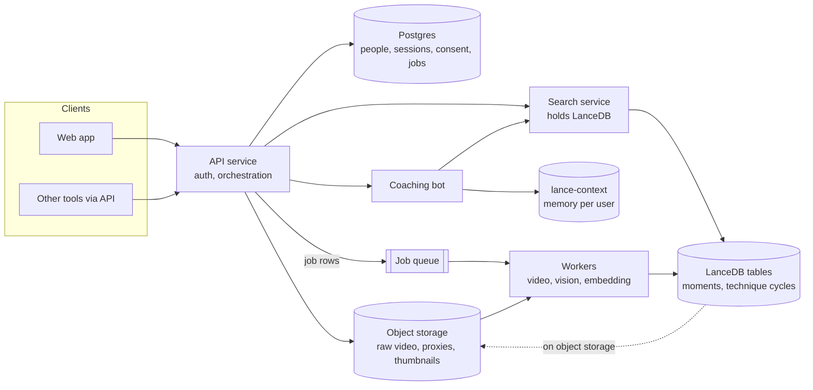
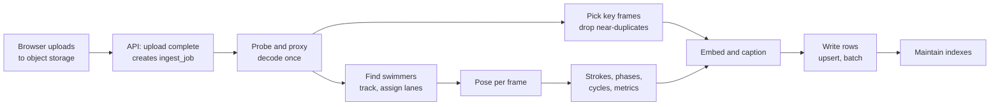

A coach has hours of pool video and a short memory. The question is never "open file 31". It is "show me every time Mia's hand entered late on freestyle this month, and how that compares with September". Folders and file names cannot answer that. A system that understands what is in the video can.

This post is a system design for that service. It states the purpose and the requirements first, then the data stores, the ingestion pipeline, the query paths, the API and the technology choices, and it names the algorithms used at each step. It is a design, not a report on a running system. Facts about LanceDB and lance-context come from their documentation, and each place where this post goes beyond the documentation says so.

## 1. Purpose and users

**Purpose.** Let a person find the exact moment in swim video that matches a description, an example picture or a set of filters, compare technique across time, and get answers that point to evidence in the video.

**Who it is for.** Two groups use it, and the first decision is which one the product serves first.

| | Coach | Swimmer |
| --- | --- | --- |
| Question | "Which of my swimmers drop their elbow after 100 m?" | "What did I change since last month?" |
| Data scope | Many swimmers, many sessions | Own videos only |
| Volume of videos reviewed | High, the main pain | Low |
| Who pays and decides | Usually the coach or the club | Rarely alone |

**Recommendation: build for the coach first, and give the swimmer a filtered view of the same data later.** The coach feels the pain of volume, and the coach's scope is a superset of the swimmer's. A swimmer view then becomes an access rule, not a second product. Confirm this with real coaches before building.

Swimmers are often minors, and the video shows identifiable people in swimwear. That makes privacy a requirement from the first day, not a later feature (section 2).

## 2. Requirements

### Functional requirements

1. **Upload** videos and images with details: swimmer, session, pool, lane, camera angle and date. Allow time-stamped notes such as "0:42 breakout".
2. **Process uploads in the background.** Cut each video into segments, extract frames, compute search vectors and swim metrics, and show the progress.
3. **Search** by words ("late hand entry on freestyle"), by example (a frame or a clip), and by filters (swimmer, date, stroke, lap, phase), alone or combined.
4. **Open the result at the right second** in the original video.
5. **Compare** two clips side by side: the same swimmer over time, or a swimmer against a reference.
6. **Annotate.** Coaches add notes and labels to a moment, and the labels become searchable.
7. **Ask a bot** questions in plain language and get an answer that lists the moments it used. The bot remembers each user's earlier questions and conclusions.
8. **Control access.** A swimmer sees their own data, a coach sees their group, a guardian sees what they consented to.
9. **Expose all of this through an API** so the web app, a mobile app or another tool can use it.

### Non-functional requirements

Targets are not given as numbers here. Set each one with the people who will use the product, and measure it on a golden set (section 9).

| Area | Requirement |
| --- | --- |
| Interactivity | Search feels instant while the coach looks at the screen. Processing can take minutes to hours without harm |
| Reliability of upload | A dropped connection never loses a video. Uploads resume |
| Retrieval quality | Searches return the right moment near the top. Measured as recall at 10 on a labelled set |
| Explainability | Every bot answer lists the moments it used. No evidence, no answer |
| Privacy | Consent per swimmer, deletion that really deletes, access by role, audit of who saw what |
| Durability | Raw video and annotations survive a failure. Search data can be rebuilt |
| Cost | Raw video is the largest cost. Everything derived from it must stay small |
| Operability | A small team can run it. Few moving parts, each with a reason |

On privacy, treat vectors and pose data like the video itself, because they can reveal who is in it. Rules for minors and for images of people differ by country, so ask the people responsible for that before real data goes in.

## 3. The system in one picture

The product is retrieval-augmented generation, with one change: the things retrieved are video moments, found by similarity and meaning, not text passages. The bot reads the retrieved moments and their measurements, then answers.



Each box does one job.

- **Web app and API clients** talk only to the API service.
- **API service** checks who the caller is, creates records, hands out upload links and calls the other parts. It never touches video bytes.
- **Postgres** is the source of truth for who and what: people, sessions, consent, annotations and job state.
- **Object storage** is the source of truth for bytes: the original video and the files made from it.
- **Search service** is the only process that opens the LanceDB tables. Access rules are applied here, in code.
- **LanceDB tables** hold the search data: vectors, short text and measurements per moment. They are derived data. If lost, they can be rebuilt from object storage and Postgres, which is what makes a model upgrade safe.
- **Workers** turn each upload into rows.
- **Coaching bot and lance-context** answer questions and remember what each user asked and concluded.

### Embedded, not a server

LanceDB's open-source edition is an embedded library. The [documentation](https://docs.lancedb.com/oss/v0-41-0/index.md) describes it as running inside your application process, with no separate database server to deploy. A client-server database such as Postgres works the other way: a separate server owns the data and applications connect over the network.

| | Embedded (LanceDB open source) | Client-server (Postgres) |
| --- | --- | --- |
| What you run | Your own service, with the library inside | Your service plus a database server |
| Access control | None built in. Use your service and the storage permissions | Database accounts and privileges |
| Concurrent writers | Optimistic concurrency: conflicting writes can fail and your code must retry | The server coordinates writers with locks and transactions |
| Best at | Similarity search over vectors and media, append-heavy data | Business records that need exact updates and relations |

That is why the design uses both: Postgres for records that change exactly and carry permissions, and LanceDB for search. It is also why one search service owns the LanceDB tables and applies the access rules. A server edition exists as LanceDB Enterprise, which the documentation lists as bring-your-own-cloud or managed.

## 4. Data stores

### 4.1 Postgres: the business records

This is a sketch of the data model for discussion, not a schema. Creating the real tables is a separate step with its own review.

| Table | Purpose | Main columns |
| --- | --- | --- |
| `club` | Tenant boundary | id, name |
| `app_user` | Anyone who signs in | id, club_id, role (coach, swimmer, guardian, admin), identity provider subject |
| `swimmer` | The person in the video | id, club_id, display name, birth year only, optional link to `app_user` |
| `swimmer_group` and membership | Who coaches whom | group id, coach, swimmer ids |
| `training_session` | A practice or a meet | id, club_id, date, pool, course length, event |
| `video` | One uploaded file | id, session_id, storage key, status, duration, frame rate, camera angle, checksum, uploaded by |
| `video_lane` | Which swimmer is in which lane of a video | video_id, lane number, swimmer_id, from and to time |
| `annotation` | Coach notes and labels | id, moment_id, author, text, labels, created at |
| `consent` | What a swimmer or guardian allowed | swimmer_id, scope, granted by, granted at, revoked at |
| `ingest_job` | Processing state | id, video_id, stage, status, attempts, last error |
| `audit_event` | Who looked at what | user, action, object, time |

Why these choices:

- **Exact relations live here.** A coach sees a group, a swimmer belongs to groups, consent can be revoked. These need transactions and constraints, and Postgres is built for them.
- **`video_lane` solves "who is in the video".** A pool video often shows several lanes. Faces are not needed: a coach or a lane-reading step assigns each lane to a swimmer for a time range, and every moment found in that lane inherits the swimmer.
- **Store a birth year, not a birth date,** and no more personal detail than the product needs.
- **`ingest_job` doubles as the queue** at first (section 5.1).

### 4.2 Object storage: the bytes

| Prefix | Content | Notes |
| --- | --- | --- |
| `raw/{club}/{video_id}/original` | The uploaded file, untouched | Source of truth. Never rewritten |
| `derived/{video_id}/proxy/` | A playback copy | Made for streaming, see below |
| `derived/{video_id}/thumbs/` | Thumbnails of key frames | Small images for result lists |
| `derived/{video_id}/pose/` | Per-frame body keypoints | Needed to rebuild technique data without re-running the model |
| `lance/` | The LanceDB tables | A separate bucket is better, so its permissions differ |

Design rules:

- **Key by id, never by name.** A swimmer's name never appears in a path.
- **Upload straight from the browser** with presigned multipart URLs. Video bytes never pass through the API service. The upload is resumable, and the API is told when it is complete.
- **Play a proxy, not the original.** Transcode once to a widely supported codec with the index at the front of the file, so a player can fetch only the byte range it needs, and a result opens at its second without downloading the whole video. The original stays for re-processing and for a coach who wants full quality.
- **Private bucket, short-lived signed URLs, server-side encryption.** The API issues a URL only after the access check.
- **Lifecycle rules.** Move old raw video to a cheaper storage class, and delete by retention date. Deletion of a swimmer removes the original, the derived files and the table rows (section 8).

LanceDB itself can use object storage. The embedded library reads and writes the table files, with `s3://`, `gs://` or `az://` paths. Safe concurrent writes to S3-compatible stores need atomic create-only writes, and the Lance documentation warns that some stores ignore that condition, so keep one writer service until you have checked yours.

### 4.3 LanceDB: the search data

Two tables, because all vectors in one column must come from one model and one dimension, and the two vector spaces answer different questions.

**Table `moments`: one row per key frame or short clip.** It answers "find the moment that looks like or matches this".

| Column | Type | Purpose |
| --- | --- | --- |
| `moment_id` | string | Deterministic key, see section 5.3 |
| `club_id`, `swimmer_id`, `session_id`, `video_id` | string | Filters and links back to Postgres |
| `t_start_ms`, `t_end_ms` | int | Window inside the video |
| `stroke` | string | freestyle, backstroke, breaststroke, butterfly, or none |
| `phase` | string | start, underwater, breakout, swim, turn, finish |
| `camera_angle` | string | side above water, underwater, front, back |
| `lap_no` | int | Which length of the pool |
| `summary` | string | Caption and coach notes. Used for text search |
| `tags` | list of string | Labels from coaches and rules |
| `consent_scope` | string | What this row may be used for |
| `thumb_uri` | string | Thumbnail path |
| `emb_model`, `emb_version` | string | Which model made the vector |
| `embedding` | fixed-size list of float | The image-and-text vector |

**Table `technique`: one row per stroke cycle.** It answers "how does this swimmer's stroke compare".

| Column | Type | Purpose |
| --- | --- | --- |
| `cycle_id` | string | Deterministic key |
| `swimmer_id`, `video_id`, `stroke`, `lap_no` | | Filters |
| `t_start_ms`, `t_end_ms` | int | The cycle's window |
| `stroke_rate`, `cycle_time`, and other measures | float | Filterable numbers, see section 6 |
| `pose_vec` | fixed-size list of float | A vector summarising the body's motion in this cycle |
| `emb_model`, `emb_version` | string | Which method made the vector |

Decisions that matter:

- **Reference, not bytes.** The tables hold paths to video and thumbnails. LanceDB has a blob column type for images and video, but the documentation describes it as early access, so this design keeps media in object storage. That is this post's choice, not a documented recommendation.
- **One joint image-and-text vector for `moments`.** The documentation's embedding registry lists OpenCLIP for text and images, and ImageBind for text, images, audio and video. A joint model lets one query find an image from a sentence. The documentation also has a tutorial on video search with a video model. Choose by testing on your own golden set.
- **Record the model.** `emb_model` and `emb_version` let you re-embed later without guessing which rows are old.
- **Filters come first.** Every query is filtered by `club_id` and `consent_scope` before nearest neighbours are chosen (prefilter, the default).
- **Indexes.** Brute force is usually fine up to roughly a hundred thousand rows. Build a vector index when a table passes about a million rows. The documented types are `IVF_PQ`, `IVF_RQ` and `IVF_HNSW_SQ`, and the documentation suggests `IVF_RQ` or `IVF_PQ` for filtered workloads. Add `BITMAP` scalar indexes on low-variety columns (`stroke`, `phase`, `camera_angle`), `BTREE` on ids and times, `LABEL_LIST` on `tags`, and a full-text index on `summary`.
- **Versions.** Every write commits a table version, and reads can go back to one. Tag the version you evaluate against, so a result can be reproduced. Check the exact tag API names for the version you install.

### 4.4 lance-context: memory for the bot

lance-context stores the bot's memory as a versioned table. Its [README](https://github.com/lance-format/lance-context) shows the basic use. Nothing here was run.

```python title="Store and recall a user's memory"
from lance_context import Context

ctx = Context.create("s3://swim-memory/coach-17.lance")
ctx.add(
    "user",
    "How has Mia's breakout changed since September?",
    embedding=question_vector,
    metadata={"swimmer": "mia", "moments": moment_ids, "table_version": 42},
)
earlier = ctx.search(question_vector, limit=5)
version = ctx.version()
```

How this design uses it:

- **One store per user.** A coach's bot memory is personal. A separate store gives isolation without relying on a metadata filter. The documentation I read does not state limits on the number of stores or whether search can filter on metadata, so check before you rely on either.
- **What goes in.** The question, the plan, the ids and table version of the moments used, the answer, and the coach's feedback. Preferences the coach states ("I care about the first 15 m") are stored as well and recalled next time.
- **Replay.** Because each write is a version, you can check out the memory and the table at the same point and replay an answer. Feedback ("wrong", "right") doubles as evaluation data.
- **Writers.** The README says the embedded API uses direct Lance commits with one writer per dataset, so the search service or the bot service is the only writer. The documentation also describes an HTTP server mode and a control-plane mode, and marks the rollout deployment specification as a draft. Start embedded.

## 5. Ingestion: from a file to searchable rows



### 5.1 The flow

1. **Upload.** The browser sends the file in parts to object storage. The API creates the `video` and an `ingest_job` when the upload completes.
2. **Queue.** Use the `ingest_job` table as the queue (workers claim a row with `FOR UPDATE SKIP LOCKED`). It needs no new service. Move to a managed queue when the trigger in section 11 is reached.
3. **Probe and proxy.** Read the file's duration, frame rate and codec. Make the playback proxy and thumbnails in one pass, so the video is decoded once.
4. **Segment.** Pool cameras are mostly fixed, so cutting at shot changes helps little. Cut on activity instead: keep the time ranges where a swimmer is present in a lane and drop empty water.
5. **Detect, track and assign.** Detect swimmers in each frame, link detections over time with a multi-object tracker, and map each track to a lane by position. Lane to swimmer comes from `video_lane`.
6. **Pose.** Estimate body keypoints for each tracked swimmer, per frame. Save them to `derived/.../pose/`.
7. **Strokes, phases, cycles, metrics.** Section 6.
8. **Key frames.** Sample at a low rate, then drop near-duplicates: embed each frame and keep it only if its cosine distance to the last kept frame is above a threshold. Choose the threshold by labelling about a hundred pairs as same or different.
9. **Embed and caption.** Embed key frames and short clips for `moments`, and the pose summary for `technique`. A captioning model writes the `summary`. Speech-to-text on a coach's spoken commentary adds text the search can find.
10. **Write.** Batch the rows and write them with an upsert.
11. **Maintain.** A scheduled job compacts the table, folds new rows into the indexes and prunes old versions.

The video is read from object storage as a stream, in order, once per stage that needs it. It is never held whole in memory, and queries never read it.

### 5.2 Compression, in three places

- **Video.** Keep the original as uploaded. Make the proxy with a codec that every browser plays. A newer codec saves bytes at the cost of compatibility and encoding time, so adopt one when storage cost, not playback, is the problem.
- **Vectors.** Index compression is the large saving. The documentation describes roughly 1/64 to 1/16 for `IVF_PQ`. The Lance file format also lists general encodings such as dictionary, run-length, bit-packing and LZ4 or Zstd compression for other columns, so short text and numbers stay small. Check the exact encodings in the format documentation for your version.
- **Pose and thumbnails.** Store keypoints as 16-bit floats and thumbnails as a compact image format. They are rebuildable, so lossy is acceptable.

### 5.3 Writing so that retries are safe

- **Deterministic keys.** `moment_id = hash(video_id, track_id, t_start_ms, emb_model, emb_version)`. The same moment always gets the same key.
- **Upsert, not append.** The documentation warns that a timed-out write may already have committed, so retrying an append can duplicate rows. `merge_insert` on the key makes a retry safe.

```python title="Idempotent write"
(
    table.merge_insert("moment_id")
    .when_matched_update_all()
    .when_not_matched_insert_all()
    .execute(rows)
)
```

- **Check key uniqueness yourself.** The documentation says a declared key is not enforced as unique, so run a daily query for duplicate or null keys.
- **Batch.** Write thousands of rows at a time. Many tiny writes create many small files.
- **Concurrency.** LanceDB uses optimistic concurrency: conflicting changes can fail and must be retried by your code. Keep one writer service and retry with backoff.
- **Coach labels reach the table the same way.** When a coach adds a label in Postgres, an update with the same key changes `tags` on the row.

## 6. The algorithms, step by step

These are the methods the design relies on, and what each is for. Every numeric setting is a starting point to tune against your own questions.

| Step | Method | Why it is there |
| --- | --- | --- |
| Find swimmers | Object detection on each frame | Know where to look, ignore the rest of the frame |
| Follow swimmers | Multi-object tracking | Keep one identity as a swimmer is hidden by splash or lane ropes |
| Body position | Pose estimation, 2D keypoints | The input for technique measures |
| Stroke type | A classifier over a window of poses or video features | Label each segment, so filters and metrics fit the stroke |
| Phase | Temporal segmentation: start, underwater, breakout, swim, turn, finish | Compare like with like, such as breakouts with breakouts |
| Stroke cycles | Peak detection on a smoothed keypoint signal, such as a wrist's height | Cut the swim into cycles for rate and comparison |
| Cycle comparison | Dynamic time warping over normalised keypoint sequences | Compare two strokes of different speed |
| Search vectors | A contrastive image-and-text model, cosine distance | Find a moment from words or a picture |
| Near-duplicate removal | Cosine distance to the last kept frame | Keep the table small |
| Approximate search | IVF-based index with product or residual quantization | Fast search at a million rows and more |
| Hybrid search | Vector search plus BM25 over `summary`, merged by reciprocal rank fusion | Find both by meaning and by exact words |
| Reranking | A cross-encoder on the top candidates | Improve the final few results |
| Technique deviation | Mean distance to the nearest reference cycles | A score for "this stroke looks different from the reference" |
| Bot answers | Retrieval, then a language model that must cite moment ids | Grounded answers |

### 6.1 Swim measures

From poses and cycles the pipeline computes measures a coach already uses: stroke rate, cycle time, strokes per length, split and lap times, underwater distance and breakout position, and turn time. Some need calibration. Distances need the pool length and a known reference in the image, which is why `training_session` stores the course length and the camera angle is a column.

### 6.2 What is hard

- **Water.** Splash, bubbles, glare, refraction and lane ropes hide the body. Keypoint models trained on dry-land images can fail in water. Evaluate on your own labelled pool footage before trusting any measure, and keep a confidence value with every measure.
- **Underwater versus above water.** The two views need different handling. Treat `camera_angle` as a first-class filter and evaluate each angle separately.
- **Identity.** A tracker can swap two swimmers in neighbouring lanes. Lane assignment from `video_lane`, checked by a person for new pool setups, limits the damage.
- **No claims without a golden set.** The document gives no accuracy numbers because none were measured.

### 6.3 Technique similarity and the fault library

1. Normalise each cycle: centre on the body, scale by torso length, resample to a fixed number of steps.
2. Encode the cycle to `pose_vec` with a small temporal model, or use the normalised sequence directly and compare with dynamic time warping. Start with the simpler one.
3. For each stroke and camera angle, keep a **reference set** of cycles a coach marks as good form.
4. A new cycle's deviation score is its mean cosine distance to its nearest reference cycles.
5. Keep a **fault library**: cycles a coach labelled with a named fault, such as "dropped elbow". A new cycle close to a labelled fault gets that name. A cycle far from both goes to a person.

This is distance-based, simple and explainable. It will not catch a fault that looks normal in the vector space.

## 7. Query paths end to end

### 7.1 Words, with filters

1. The coach types: "late hand entry on freestyle, Mia, last month".
2. The API authenticates the caller and loads their group.
3. A language model turns the sentence into a **filter object** with allowed fields only (swimmer, date range, stroke, phase). The code validates it. The model never writes a query string.
4. The search service embeds the words and runs a hybrid search with the filter and the access filter applied first.
5. The top candidates are reranked.
6. The API joins names and notes from Postgres and returns each hit with a thumbnail URL and a proxy URL at `t_start_ms`.

```python title="Filtered vector search"
hits = (
    moments.search(query_vector)
    .where(
        "club_id = 'c1' AND swimmer_id = 's42' AND stroke = 'freestyle' AND t_start_ms > 0",
        prefilter=True,
    )
    .limit(20)
    .to_list()
)
```

Prefilter is the default in LanceDB. A postfilter picks neighbours first and removes rows after, which can return fewer than the limit, even zero, as the documentation says.

```python title="Hybrid search"
moments.create_fts_index("summary")
hits = (
    moments.search(query_type="hybrid", vector_column_name="embedding", fts_columns="summary")
    .vector(query_vector)
    .text("late hand entry")
    .limit(50)
    .to_list()
)
```

LanceDB merges the two result lists with reciprocal rank fusion by default, where each result gets `1 / (K + rank)` from each list and `K` defaults to 60. Retrieve more than you need and cut after reranking.

### 7.2 By example

The coach picks a frame or uploads a picture. The same embedding model turns it into a vector, and the search runs with the same filters. Results are moments that look alike, even if no one wrote a caption.

### 7.3 Compare

The coach picks two cycles. The service returns their measures side by side and the alignment from dynamic time warping, and the web app plays both proxies with the aligned timeline. This is a lookup in `technique`, not a search.

### 7.4 Ask the bot

1. Recall the user's relevant earlier records from lance-context.
2. A language model plans the steps and calls tools: search moments, get measures, compare cycles. **The tools are the same search service,** so the access filter applies.
3. Read a bounded number of rows. Open full video only for the few moments that matter.
4. Write an answer that lists the moment ids. If no row passes a minimum score, say "no matching data".
5. Write the record to lance-context: question, plan, ids, table version, answer.

The bot cannot widen its own access. The gateway adds the role filter in code, never in the prompt.

## 8. Privacy, consent and deletion

- **Consent per swimmer.** Every row carries `consent_scope`, and the search service filters on it. Revoking consent in Postgres starts a job that updates or deletes the rows.
- **Vectors are personal data.** Give them the same access and retention as the video.
- **Deletion is a job.** For a swimmer or a video, delete the row in Postgres, the original and derived files, the table rows, and prune old table versions. A table's version history is not a backup, as the documentation says, and deleted data is not physically erased at once. Run the job on a schedule and verify that all three are gone.
- **Back up** the object storage and Postgres with their own tools.
- **Audit.** Write an `audit_event` for each view of a swimmer's video.
- **Minors.** Ask the people responsible for compliance in your country before the first real upload.

## 9. The API

A small, versioned REST surface. The API service is the only public entry point.

| Method and path | Purpose |
| --- | --- |
| `POST /v1/uploads` | Create the video record and return presigned multipart URLs |
| `POST /v1/uploads/{id}/complete` | Mark the upload finished and create the job |
| `GET /v1/videos/{id}` | Status, details and a short-lived playback URL |
| `POST /v1/search` | Text, example or filters in. Moments out, each with thumbnail, time and score |
| `GET /v1/moments/{id}` | One moment with its measures and notes |
| `POST /v1/moments/{id}/annotations` | Add a note or label |
| `POST /v1/compare` | Two cycles in. Measures and alignment out |
| `GET /v1/swimmers/{id}/metrics` | Measures over a date range |
| `POST /v1/ask` | A question in. A streamed answer with evidence ids out |
| `PUT /v1/consents/{swimmer_id}` | Record or revoke consent |

Rules: sign-in through an identity provider that issues tokens carrying the user's role and club, an API key flow for other tools, the access filter built from the token and never from the request, and an idempotency key on uploads and writes.

## 10. Technology choices

| Part | Recommendation | Why | What it costs |
| --- | --- | --- | --- |
| API, search service, workers | **Python, one codebase** | The vision, embedding and pose tools are in Python. The documented LanceDB SDKs are Python, TypeScript and Rust. lance-context installs with `pip` | Slower per request than a compiled language, which is rarely the bottleneck here |
| Business API on the JVM | Use only if your team already runs Spring Boot | Familiar for CRUD, security and Postgres | The embedded LanceDB documentation lists no Java SDK, so a Spring Boot service would call the Python search service, adding a hop and a contract to keep |
| Rust | Later, for a hot spot such as video decoding or a tracker | An official LanceDB SDK exists, and Rust is fast | A slower build, and a smaller set of ready vision libraries |
| Database | Postgres | Relations, transactions, row-level rules | A server to run or buy |
| Queue | The `ingest_job` table first | No new service | Polling, and a limit on throughput |
| Video tools | A standard command-line video toolkit in the workers | One decode pass, proven | Needs CPU and sometimes a GPU |
| Object storage | S3 or an S3-compatible store | Cheap, durable, signed URLs | Egress cost, and the atomic-write check for LanceDB |
| Front end | A web app with a player that fetches byte ranges | Plays proxies at a given second | Browser codec limits |
| Identity | An OpenID Connect provider | Roles in the token | Setup and a vendor |

**Recommendation: start with Python for everything, one image for the API and one for the workers, built from the same code.** Add the JVM or Rust only for a stated reason.

## 11. Scale on demand

| Trigger | Next step | Cost |
| --- | --- | --- |
| Table passes about a million rows | Build a vector index and scalar indexes | Build time and a maintenance job |
| Jobs wait too long | More workers, or a managed queue | Another service |
| Several writers conflict | Partition writers by key range, retry with backoff | More moving parts |
| Many users search at once | Run several search-service replicas that only read, one writer | Caches in every replica, and `read_consistency_interval` to see new rows |
| Table too large to maintain comfortably | Split by club or month | Queries name several tables |
| A new embedding model | A new column or table, backfill, switch, drop the old one | GPU time for the backfill |
| Bot memory needs several writers | lance-context HTTP server mode | A draft specification, shared storage |
| A club needs data kept apart | Separate buckets and tables per club | More to operate |

Each open search-service process keeps its own caches, and they are not shared between processes. The [Lance performance guide](https://lance.org/guide/performance/) gives default ceilings of 1 GiB for metadata and 6 GiB for the index. A new process starts with empty caches, so its first queries are slower. Prefer a few larger search services over putting LanceDB in every app.

## 12. Checking that it works

- **Retrieval.** A golden set of questions with the moments that should be found. Report recall at 10 and mean reciprocal rank. Re-run it after every model, index or segmenting change, and tag the table version you ran it on.
- **Measures.** Compare each automatic measure with a coach's or a stopwatch's value on a labelled sample, per camera angle.
- **Tracking.** Count identity swaps on labelled lanes.
- **Technique deviation.** Precision and recall against faults coaches labelled, and alerts per swimmer per week.
- **Bot.** A coach marks a sample of answers right, wrong or unsupported. Track the share that cite real moments.
- **Operations.** A restore drill, a deletion drill and an upload-with-no-network drill, each on a schedule.

## 13. What makes the product distinct

- **Evidence first.** Every answer opens a moment in the video.
- **Search by example.** "Find moments like this one" works without anyone typing a caption.
- **Technique comparison.** Cycles are aligned, so the same stroke at different speeds can be compared.
- **A memory per user.** The bot remembers what this coach cares about and what it concluded last time.
- **A rebuildable index.** Search data is derived from raw video and Postgres, so a better model means a backfill, not a migration of the originals.
- **Privacy built in.** Consent, audit and deletion are part of the design.

None of this is proven until it runs on real pool footage.

## 14. Limits of this design

- It is a design. It has not been run, and no accuracy or speed figures are claimed.
- The object-storage reference pattern, the two-table split, the segmenting, the technique method and the bot flow are this post's own choices, not recommendations from the LanceDB documentation.
- Blob columns are described as early access in the documentation, and this design avoids them on purpose.
- The embedded documentation lists no Java SDK, and the lance-context facts come from its README and documentation, which this post did not run. Its rollout deployment specification is a draft.
- The documentation does not state a maximum number of rows per table or a maximum vector dimension for the embedded version.
- Pose estimation in water is the main technical risk. Test it before building the rest.
- API calls follow the LanceDB 0.41 documentation. Check names and parameters against the version you install.

## What to do on Monday

1. Decide the first user. Talk to two coaches, and write the five questions they ask most.
2. Collect one session of video from one pool, with the lanes labelled.
3. Run pose estimation on it and look at the failures by eye, above and below water. This decides whether the technique features are possible.
4. Load key-frame vectors into one `moments` table and run the five questions with hybrid search. Measure recall at 10.
5. Only then build upload, the job queue and the API around what worked.

## Related

- [Inside lance-context: one storage engine for agent memory and RL rollouts](../inside-lance-context-ai-data-storage/)
- [Searchable robot data with LanceDB and lance-context](../searchable-robot-data-with-lancedb-and-lance-context/), the earlier and more general version of this design

## Sources

- [LanceDB open source documentation, version 0.41](https://docs.lancedb.com/oss/v0-41-0/index.md)
- [LanceDB client SDKs](https://docs.lancedb.com/oss/v0-41-0/basics/sdk.md)
- [LanceDB embedding functions](https://docs.lancedb.com/oss/v0-41-0/embedding/index.md)
- [LanceDB tables, blobs and versions](https://docs.lancedb.com/oss/v0-41-0/management/table.md)
- [LanceDB read consistency](https://docs.lancedb.com/oss/v0-41-0/tables/consistency.md)
- [LanceDB merge insert](https://docs.lancedb.com/oss/v0-41-0/ingestion/merge-insert.md)
- [LanceDB video search tutorial](https://docs.lancedb.com/oss/v0-41-0/tutorials/search/video-search.md)
- [Lance file format encodings](https://lance.org/format/file/encoding/)
- [Lance blob format](https://lance.org/format/table/blob/)
- [Lance object store guide](https://lance.org/guide/object_store/)
- [Lance performance guide](https://lance.org/guide/performance/)
- [lance-context repository](https://github.com/lance-format/lance-context) and its [documentation](https://lance.org/integrations/context/)
