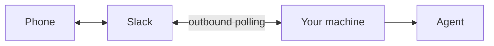

A coding agent is most useful when it runs for hours. It is least useful at the moment it needs a human: a decision, an approval, a missing fact. If you are away from the machine, it waits.

slack-relay turns that wait into a message. The agent runs on your own machine, polls a Slack app over HTTPS, treats each allowlisted message as a task, and answers in the same chat. Your phone supplies the push notification.

## Three choices that matter

- **Outbound polling.** Nothing listens on a port, so there is no tunnel or public endpoint to defend. The price is a few seconds of latency.
- **A thin script owns the network.** The agent never holds the token. It runs a small client and reads JSON.
- **The allowlist is the real boundary.** A chat message from an allowlisted user carries the same authority as typing in the terminal. Everything else is ignored before the agent sees it.

## What it costs

The machine must stay awake and online, files and images are not supported, and an unattended session stalls if a command needs an unapproved permission prompt. Those are the first things to fix next.

The full design, the threat model and a team-scale version are in the [system design](../../slack-relay/system-design/), and the operating guide is in the [runbook](../../slack-relay/runbook/).
