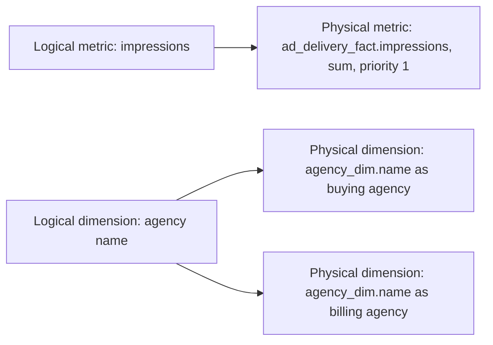

A person asking for impressions by advertiser does not care which table holds the impressions. The people running the gateway care a great deal, because the same measure may be stored in several places, at several grains, in several kinds of database. The way to serve both is to keep two models and bind them together: one in business terms, one in terms of tables and columns.

This post covers that split, the rule that keeps a breakdown honest, the failures a request can run into, and what it costs to keep it all as data. [The first post](../why-a-semantic-layer-exists/) explained why a semantic layer exists. Every example here uses the same invented ad-reporting model as the rest of the series.

## The model the examples use

The invented world has one delivery fact table and a chain of dimension tables above it.

| Table | Grain |
|---|---|
| `ad_delivery_fact` | delivery |
| `publisher_site_dim` | delivery |
| `line_item_dim` | line item |
| `creative_dim` | line item |
| `campaign_dim` | campaign |
| `advertiser_dim` | advertiser |
| `agency_dim` | agency |

Grain orders these from fine to coarse: delivery, line item, campaign, advertiser, agency. A delivery is the finest thing the model records, and an agency is the coarsest.

## Two models, bound together

The business-level model says what can be asked. The storage-level model says where the answer lives. A binding connects them.



- A **logical metric** is a business-named measure that does not depend on where it is stored. `impressions` is one.
- A **physical metric** is a logical metric bound to a column of a specific table, with an aggregation and a priority. `ad_delivery_fact.impressions`, summed, is one binding of it.
- A **logical dimension** is a business-named label you can slice or filter by, with a data type and a grain. `agency name` has the grain of an agency.
- A **physical dimension** is a logical dimension bound to a column of a specific table. The agency name is bound to `agency_dim` twice, once for each role the table plays, buying agency and billing agency.

In TypeScript the four terms are small records.

```ts
type Grain = 'delivery' | 'line_item' | 'campaign' | 'advertiser' | 'agency'

interface LogicalMetric {
  name: string
}

interface PhysicalMetric {
  metric: string
  table: string
  column: string
  aggregation: 'sum' | 'count' | 'max'
  priority: number
}

interface LogicalDimension {
  name: string
  dataType: 'text' | 'number' | 'date'
  grain: Grain
}

interface PhysicalDimension {
  dimension: string
  table: string
  column: string
  role?: string
}
```

The split pays off the first time storage changes. If the impressions move to a different table, one physical metric changes and every request that names `impressions` keeps working.

## Why a metric table cannot be broken down by a finer dimension

Grain is not decoration. It decides what a table can truthfully answer.

Suppose the model also stores a planned budget on `campaign_dim`. Its grain is campaign, so each row already summarizes everything below it. Ask for that budget by creative, and a creative belongs to a line item, which is finer than a campaign. The table has one budget per campaign and no way to say how much of it belongs to each creative. Any answer would be an invention: either the whole budget repeated against every creative, or a split the data does not support.

The other direction works. Impressions live at delivery grain, so they can be broken down by line item, campaign, advertiser or agency, because each of those is a coarser grouping of deliveries. The rule is one comparison.

```ts
const grainOrder: Grain[] = ['delivery', 'line_item', 'campaign', 'advertiser', 'agency']

function canBreakDown(metricTableGrain: Grain, dimensionGrain: Grain): boolean {
  return grainOrder.indexOf(dimensionGrain) >= grainOrder.indexOf(metricTableGrain)
}
```

A metric table can be broken down only by dimensions at its own grain or coarser. When the comparison fails, the gateway refuses rather than returning a number that looks right.

This is also where fan-out comes from. Joining a coarse table to a finer one makes one row on the near side match many on the far side, and the near side's measures get counted more than once. Checking grain before joining stops the worst cases at the door.

## Choosing among several physical metrics

One logical metric can have several physical metrics. Spend might be stored per delivery in the fact table and as a booked amount per campaign, and each binding carries a priority, where a lower number is tried first.

The choice has two steps. First, drop every candidate that cannot answer the request, which includes any whose table grain is finer than a requested dimension. Second, take the candidate with the best priority. If two survive with the same best priority, the gateway has no principled way to choose, so it refuses and names the candidates.

```ts
function pickPhysicalMetric(all: PhysicalMetric[], metric: string): Outcome<PhysicalMetric> {
  const matching = all.filter((candidate) => candidate.metric === metric)
  if (matching.length === 0) return { ok: false, reason: { kind: 'unknown_metric', metric } }
  const best = Math.min(...matching.map((candidate) => candidate.priority))
  const top = matching.filter((candidate) => candidate.priority === best)
  if (top.length > 1) {
    return {
      ok: false,
      reason: {
        kind: 'ambiguous_metric',
        metric,
        candidates: top.map((candidate) => `${candidate.table}.${candidate.column}`),
      },
    }
  }
  return { ok: true, value: top[0] }
}
```

Refusing is the right default. A tie that is silently broken by table name or load order produces a number that changes when someone adds a table.

## Failures that explain themselves

A request can fail for several different reasons, and a consumer needs to know which one. A message that says "could not build the query" sends them to the people who run the gateway. A typed reason lets the consumer fix the request, and lets the gateway's operators count which failures happen most.

```ts
type FailureReason =
  | { kind: 'unknown_metric'; metric: string }
  | { kind: 'ambiguous_metric'; metric: string; candidates: string[] }
  | { kind: 'grain_too_fine'; metric: string; dimension: string; metricGrain: Grain; dimensionGrain: Grain }
  | { kind: 'no_route'; from: string; to: string; hopLimit: number }
  | { kind: 'spans_databases'; databases: string[] }

type Outcome<T> = { ok: true; value: T } | { ok: false; reason: FailureReason }
```

Three of these deserve a closer look.

**Ambiguous metric.** Two physical metrics tie on priority, as above. The reason lists the candidates so the author can either add a priority or ask for a more specific metric.

**No route.** The metric table cannot reach a requested dimension table within the hop limit, either because no join rules connect them, because the only ones are switched off, or because the shortest chain is longer than the limit. The reason names both tables and the limit. [The next post](../finding-the-join/) shows how routes are found and why a route can be missing.

**Selection spanning several databases.** Suppose, in this invented world, the delivery fact sits in a columnar analytics store and the dimension tables sit in a row store. A request that needs a column from each cannot be answered by one query, because a join does not cross the boundary between them. The gateway reports `spans_databases` with the databases involved instead of attempting something slow or wrong. The author can then ask for a selection that stays in one database, or the model can be changed so that it does.

Because each reason is a value with named parts rather than a string, a client can branch on `kind`, show a tailored message, and a dashboard can chart the counts.

## Virtual tables

A virtual table is a registered view of a table that states which metrics, breakdowns and filters it can answer. It is the unit the gateway chooses among. Registering one is a promise: this table answers these questions, at this grain, with these filters.

That promise is what lets the gateway pick a table by looking at metadata alone. A request for impressions by agency only needs to find virtual tables that list impressions and a breakdown by agency, then apply the grain rule and the priority. It never inspects the data to decide.

## Metadata as data

Logical metrics, logical dimensions, their bindings, join rules and virtual tables are all metadata, and the gateway reads them at run time. They are managed as data, not compiled into the service. A change to a binding or a join rule is a record that is reviewed, versioned and rolled back like any other change to data, and the gateway picks it up without a redeploy.

Two things follow. A business user can propose a new logical metric without touching service code, and a mistake in a binding is reverted by reverting a record. The cost is that the gateway must treat the metadata as untrusted input: every record is validated when it is loaded, and a bad one is rejected with a reason, in the same typed form as a failed request.

## Pros and cons

| | Advantage | Cost |
|---|---|---|
| Two models | Storage can move without breaking any request | Every metric and dimension needs a binding kept in step with the tables |
| Grain rule | A breakdown the data cannot support is refused, not guessed | Some requests are refused that a person might have wanted answered approximately |
| Priorities | Several physical metrics can serve one logical metric | Ties must be resolved by the author, and priorities need maintenance |
| Typed reasons | Consumers fix their own requests, and failures can be counted | Every new kind of failure needs a type, a message and a test |
| Virtual tables | Table choice is a metadata lookup | A table that is not registered is invisible, even if it holds the answer |
| Metadata as data | Changes need review, not a deploy | The gateway must validate its own configuration |

## When not to build this

- **One database, one grain.** If every metric lives in one table and nobody asks for a breakdown that the table cannot support, grain and priority add rules with nothing to decide.
- **No second physical home for any metric.** The logical and physical split earns its keep when one measure is stored in more than one place or is likely to move. Without that, a single set of named definitions is enough.
- **Nobody to own the bindings.** Each binding is a claim that a column means what the metric says. A claim with no owner goes stale quietly, and a stale binding gives a confident wrong answer.
- **Requests that arrive as ready-made queries.** If consumers already write correct SQL against a stable schema, a refusal system gives them little.

## What it costs

The costs are the bindings, the priorities and the reasons. Each one is more metadata to review and more behavior to test, and the grain rule will sometimes refuse a request that someone had a good reason to make. Plan for refusals to be a visible and frequently read part of the product, because the typed reason is the interface for the person who got no answer. [The last post](../building-the-platform/) covers the service that carries all of this.

## Related

- [Why a semantic layer exists](../why-a-semantic-layer-exists/)
- [Finding the join](../finding-the-join/)
- [Building the platform](../building-the-platform/)
