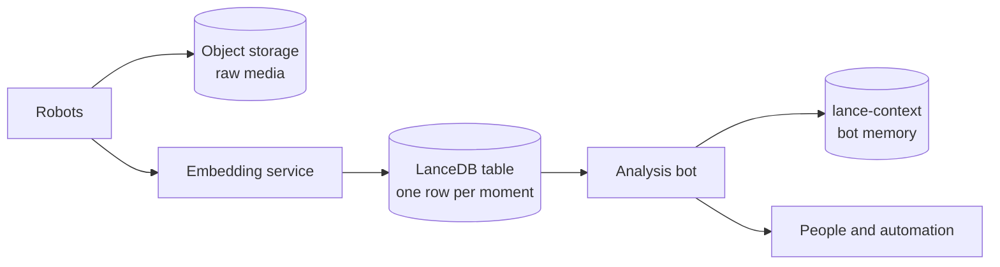

A fleet of robots collects far more than anyone reads: camera frames, short video clips, audio, sensor readings and text logs. The data is only useful if someone can ask a question in plain words, such as "show me the times the gripper slipped, with the sound it made", and get the matching moments back. This is a problem for the operators who debug the fleet today, and for the doctors, nurses or technicians who will use the robot's output tomorrow.



## The approach

Treat every robot observation as one row, and keep the heavy bytes out of the row. The design has three parts that each do one job.

- **Raw media stays in object storage.** Frames, clips and audio are written once, as files. The row stores a reference to the file, not the file. This keeps the table small and fast to scan, and the cost is a second hop when someone opens the original.
- **[LanceDB](https://lancedb.github.io/lancedb/) holds one row per moment and answers the question.** A row has a robot id, a time, a modality, the file reference, a short text description, ordinary metadata columns and an embedding vector. A query combines a similarity search on the vector with a filter on the metadata, for example "similar to this sound, from robot 7, last week". Adding image, audio and video rows is the same table with a different modality value, so there is one query path, not one per media type.
- **The analysis bot keeps its own memory in [lance-context](../inside-lance-context-ai-data-storage/).** The bot asks questions, reads the rows it gets back and writes conclusions. Its history is stored as a versioned table on the same object storage, so a past answer can be replayed against the data snapshot it was based on.

A row can be as small as this:

```python title="One observation row"
observation = {
    "robot_id": "robot-07",
    "observed_at": "2026-11-24T09:15:02Z",
    "modality": "audio",
    "media_uri": "s3://fleet-media/robot-07/2026-11-24/091502.wav",
    "summary": "grinding noise while closing the gripper",
    "site": "ward-3",
    "embedding": embed(media_bytes),
}
```

Embedding is a service call, not part of the robot. The robot only has to send raw data and a timestamp, and the same table can be re-embedded later with a better model.

> [!NOTE]
> Every answer the bot gives must list the rows it used. A person who can open the original clip can check the answer, and a bot with no cited rows is only guessing.

## How it gets used

The same table serves three kinds of consumers without a new system for each.

- **Operators** ask for failures and near-misses by description or by example clip.
- **Automation** runs a saved query on a schedule. A new observation that is far from anything seen before, or close to a known fault, raises a ticket or stops a task.
- **Other roles**, such as a doctor reviewing what a care robot saw, get the same search through the bot, limited to the rows their role may read.

Because rows are tagged with site, robot and role-relevant columns, this limit is a filter on every query, not a separate copy of the data.

## Scale on demand

Start with the smallest version: one embedded table, one writer, one bot. Move only when a trigger fires.

| Trigger | Next step | Cost |
| --- | --- | --- |
| Several processes write at once | Run the storage server and give each writer its own shard | One more service to run |
| Searches get slow on a large table | Add a vector index and indexes on the filter columns | Index build time and storage |
| Data grows past what one table handles comfortably | Split tables by site or by month and query across them | Queries must name the tables |
| The embedding model changes | Add a new embedding column and backfill it, keep the old one until the new one is checked | Compute for the backfill |
| Many bots or teams share the data | Add per-role access rules at the gateway in front of the table | Rules to design and review |

## What it costs

- **Embeddings are not private.** An embedding of a face, a voice or a patient room can leak what it came from. Treat vectors with the same access rules as the raw media.
- **Consent and retention come first for people in view.** Decide what is kept, for how long and who may see it before the first robot records. Deleting a row must also delete the file and its embedding.
- **Search finds similar, not correct.** A close match can still be the wrong moment. Keep a person in the loop for any decision that affects a patient, and do not let automation act on a single match.
- **Re-embedding is real work.** Changing the model means a backfill, and results from old and new vectors are not comparable until it is done.
- **Not finished here.** This post describes a design, not a measured system. It gives no speed or size figures, and the multimodal embedding choice is left open on purpose.

## What to do on Monday

1. Pick one question people already ask about the robot, such as "when did it fail and what did it sound like".
2. Choose two modalities that answer it, for example audio and text logs, and write the row shape above for them.
3. Load a day of data into one embedded table, run the question as a query, and check the top ten rows by hand.
4. Only then add the bot, with a rule that it cites its rows.

## Related

- [Inside lance-context: one storage engine for agent memory and RL rollouts](../inside-lance-context-ai-data-storage/)
- [LanceDB documentation](https://lancedb.github.io/lancedb/)
