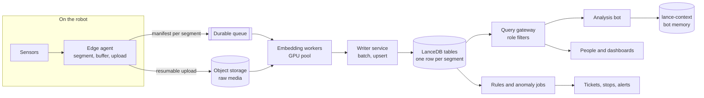
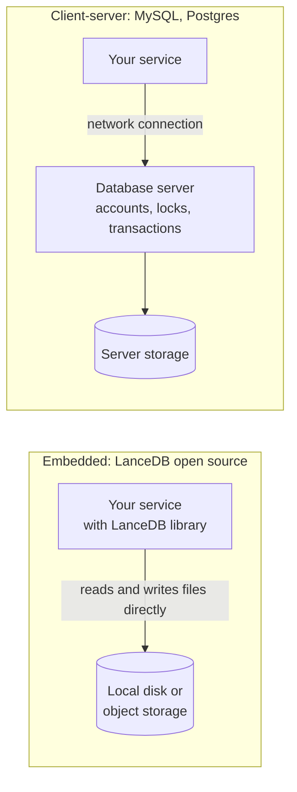

A fleet of robots collects far more than anyone reads: camera frames, video clips, audio, sensor readings and text logs. The data is only useful if someone can ask a question in plain words, such as "show me the times the gripper slipped, with the sound it made", and get the matching moments back. Operators need this to debug the fleet. Later, the same data can drive automation, or serve people who use the robot's output, such as a doctor reviewing what a care robot saw.

This post is a working design. It covers the data model, the algorithms for each step, how to deploy it, what goes wrong and how to check it. Product behaviour is taken from the [LanceDB 0.41 documentation](https://docs.lancedb.com/oss/v0-41-0/), and each place where this post goes beyond the documentation says so.

## 1. The system in one picture



Each box does one job.

- **Edge agent** cuts the streams into segments, keeps a local disk buffer so a lost connection loses nothing, and uploads raw files and a small manifest.
- **Object storage** holds the raw media. It is the only place heavy bytes live.
- **Queue and embedding workers** turn each segment into vectors. This is the only step that needs GPUs, and it can lag without breaking anything.
- **Writer service** batches rows and writes them with an upsert, so a retry never creates a duplicate.
- **LanceDB tables** answer the questions: vector search, text search and filters in one query.
- **Query gateway** adds the role filter to every query. Access rules live here, not in the bot's prompt.
- **Analysis bot and lance-context** run the questions and remember what they concluded and which rows they used.
- **Rules and anomaly jobs** run saved queries on a schedule and raise alerts.

### Embedded, not a server

LanceDB's open-source edition is an embedded library. The [documentation](https://docs.lancedb.com/oss/v0-41-0/index.md) describes it as running inside your application process, with no separate database server to deploy. A client-server database such as MySQL or Postgres works the other way: a separate server process owns the data, and applications connect to it over the network.



| | Embedded (LanceDB open source) | Client-server (MySQL, Postgres) |
| --- | --- | --- |
| What you run | Your own service, with the library inside | Your service plus a database server |
| Access control | None built in. Use your service and the storage permissions | Database accounts and privileges |
| Concurrent writers | Optimistic concurrency: conflicting writes can fail and your code must retry | The server coordinates writers with locks and transactions |
| Best at | Similarity search over vectors and media, append-heavy data | Business records that need exact updates and relations |
| Scaling | By your service and the storage underneath it | By the database server and its replicas |

This is why the design keeps one writer service and puts the access rules in the query gateway. It is also why a relational database stays the right home for transactional business data, linked to these tables by the same ids. A server edition exists as LanceDB Enterprise, which the documentation lists as bring-your-own-cloud or managed.

## 2. Data model

One table row is one segment: a short window of one stream from one robot. Keep the table narrow and put heavy bytes outside it.

| Column | Type | Purpose |
| --- | --- | --- |
| `obs_id` | string | Deterministic key, see section 5 |
| `robot_id`, `site`, `robot_model` | string | Filters and grouping |
| `stream` | string | `camera`, `audio`, `lidar`, `joint_state`, `log` and so on |
| `modality` | string | `image`, `video`, `audio`, `text`, `timeseries` |
| `t_start`, `t_end` | timestamp | Segment window by the robot clock |
| `t_received` | timestamp | Server receive time, see clock skew in section 7 |
| `media_uri` | string | Object-storage path of the raw file |
| `media_sha256` | string | Detects corruption and duplicates |
| `summary` | string | Short text: caption, transcript or log excerpt. Used for text search |
| `tags` | list of string | Labels from people or rules, for example `gripper_slip` |
| `consent_scope` | string | What this row may be used for, see section 8 |
| `emb_model`, `emb_version` | string | Which model and version produced the vector |
| `embedding` | fixed-size list of float | The vector |
| `anomaly_score` | float | Written by the anomaly job, nullable |

Decisions that matter:

- **Store a reference, not the bytes.** LanceDB has a blob column type for images, video and audio, but the docs mark the newer version as early access and describe sizes that move payloads into side files. The docs do not describe an object-storage reference pattern. Using one is this post's design choice, and the reason is simple: raw media is the largest cost, and the table stays small and fast to scan without it.
- **One table per vector space.** All vectors in one column must come from one model and one dimension. Use one table per embedding model, or one table with a joint model that covers several modalities. The docs list ImageBind (text, image, audio, video) and OpenCLIP (text, image) in the embedding registry. A joint model lets one query find an image from a sentence. Separate per-modality models are usually better at their own modality, but cannot be searched across.
- **Record the model.** `emb_model` and `emb_version` are what let you re-embed later without guessing which rows are old.

## 3. Turning raw data into rows: the algorithms

### 3.1 Segmenting

Pick the segment so that one row means one thing a person would point at.

| Stream | Method | Starting values to tune |
| --- | --- | --- |
| Audio | Fixed windows with overlap, drop windows below a loudness floor | 10 s window, 2 s hop |
| Video | Cut at shot or scene changes, plus a key frame every few seconds inside long shots | Key frame every 2 s |
| Camera frames | Sample at a low rate, then drop near-duplicates (below) | 1 frame per second |
| Sensor time series | Sliding window, one row per window | Window long enough to hold one motion cycle |
| Text logs | One row per event, or per group of events within a short gap | Gap of a few seconds |

These numbers are starting points to tune against your own questions, not recommendations from any product.

Near-duplicate removal for frames: embed each frame, keep a frame only if its cosine distance to the last kept frame is above a threshold. Choose the threshold by labelling about a hundred pairs as "same" or "different" and picking the value that separates them. This keeps a robot staring at a wall from filling the table.

### 3.2 Embedding each modality

- **Image and video:** embed key frames, and for video also embed a short clip with a video-capable model. Store each as its own row, linked by `parent_obs_id`.
- **Audio:** embed each window. If speech matters, also run speech-to-text and store the text in `summary`, so text search can find spoken words.
- **Time series:** compute window features (mean, spread, a few frequency-band energies) or use a learned encoder, then embed the feature vector. Features first is simpler and easy to explain.
- **Text:** embed `summary` with a text model.

Normalize vectors and use cosine distance everywhere. The search metric must match the metric the index was built with, or the query falls back to a full scan, as the docs state.

### 3.3 Generating the `summary`

A short caption or transcript is what makes hybrid search possible. Use a captioning model for images and video, speech-to-text for audio, and a template for sensor events ("joint 3 current above limit for 2 s"). Keep it factual and short, and never put a person's name or other identifier into it.

## 4. Querying: the algorithms

### 4.1 Vector search with a filter

```python title="Filtered vector search"
hits = (
    table.search(query_vector)
    .where("site = 'ward-3' AND t_start > '2026-11-17'", prefilter=True)
    .limit(20)
    .to_list()
)
```

Prefilter is the default in LanceDB. The filter restricts the rows first, then the nearest ones are chosen. A postfilter picks neighbours first and removes rows after, which can return fewer than the limit, even zero, as the docs say. Keep prefilter on.

### 4.2 Hybrid search

Run a vector search and a BM25 text search over `summary`, then merge. LanceDB merges with reciprocal rank fusion by default: each result gets `1 / (K + rank)` from each list, the scores add, and `K` defaults to 60. Fusion uses ranks, so you never have to compare a cosine score with a BM25 score.

```python title="Hybrid search"
table.create_fts_index("summary")
hits = (
    table.search(query_type="hybrid", vector_column_name="embedding", fts_columns="summary")
    .vector(query_vector)
    .text("grinding noise gripper")
    .limit(20)
    .to_list()
)
```

Reranking cannot recover rows that neither search retrieved, so retrieve more than you need (for example 50) and cut after. A cross-encoder reranker is available in the Python SDK for the final top few, at the cost of extra compute per query.

### 4.3 Choosing and tuning the index

Follow the docs' guidance:

- Up to roughly a hundred thousand rows, brute force is usually fast enough. Build an index when a table passes about a million rows.
- Index types are `IVF_PQ`, `IVF_RQ` and `IVF_HNSW_SQ`, all with a cosine option. The docs suggest `IVF_RQ` or `IVF_PQ` for filtered workloads, because the HNSW-based types vary more in latency when filters are used. Compression is roughly 1/64 to 1/16 for `IVF_PQ`.
- Leave `nprobes` unset first (the default search effort is automatic), then measure.

Measure recall instead of guessing. Take a sample of real queries, run each with `bypass_vector_index()` to get the exact nearest neighbours, run the same query with the index, and compute recall at 10 (the share of exact neighbours the index found). If recall is below your target, raise `nprobes` or `refine_factor`, or retrain the index. Rows written after the index was built are searched by a slower unindexed path until `optimize()` folds them in.

Also add scalar indexes on the columns you filter on: `BITMAP` for columns with fewer than about a thousand values (`site`, `stream`, `modality`), `BTREE` for times and ids, and `LABEL_LIST` for `tags`.

### 4.4 Anomaly detection and a fault library

Use the embeddings you already have.

1. For each `robot_model` and `stream`, collect a reference set of vectors from periods known to be normal.
2. For a new segment, compute its anomaly score: the mean cosine distance to its k nearest reference vectors (k around 10). Write it to `anomaly_score`.
3. Set the alert threshold as a high percentile of scores on held-out normal data, for example the 99th. Alert only when several consecutive windows exceed it, so one noisy window does not page anyone.
4. Keep a **fault library**: segments people labelled as a known fault, with their `tags`. A new segment close to a labelled fault gets that fault's name. A segment far from both normal and known faults is a new kind of problem and goes to a person.
5. Every week, compare the score distribution of new data with the reference. A shift means the environment, the sensor or the model changed, and the reference set needs a refresh.

This is a distance-based method. It is simple and explainable, and it will not catch a fault that looks like normal data in embedding space.

## 5. Writing: ingest that survives retries

Rules for the writer service:

- **Deterministic keys.** `obs_id = hash(robot_id, stream, t_start, segment_index, emb_model, emb_version)`. The same segment always gets the same key.
- **Upsert, not append.** The docs warn that a timed-out write may already have committed, so retrying an append can duplicate rows. `merge_insert` on `obs_id` makes the retry safe.

```python title="Idempotent write"
(
    table.merge_insert("obs_id")
    .when_matched_update_all()
    .when_not_matched_insert_all()
    .execute(rows)
)
```

- **Check key uniqueness yourself.** The docs say a declared key is not enforced as unique, so run a daily query that finds duplicate or null `obs_id` values.
- **Batch.** Write thousands of rows at a time, not one. Many tiny writes create many small files, and the docs log a warning when a table has 100 or more fragments with fewer than 100,000 rows each.
- **Concurrency.** LanceDB uses optimistic concurrency: concurrent appends are compatible, and conflicting changes can fail and must be retried by your code. Keep one writer service, or a few that write different key ranges, and retry with backoff.
- **Read freshness.** A reader does not see another process's commit until it reopens or sets `read_consistency_interval`. Set it on the query service, for example to a few seconds, so new rows show up without a restart.

## 6. The analysis bot and lance-context

The bot answers a question in four steps:

1. Turn the question into a plan: which tables, which filters, which query types.
2. Run the queries through the gateway, so the role filter is always applied.
3. Read at most a bounded number of rows, and open the raw media only for the few it needs.
4. Write an answer that lists the row ids it used.

[lance-context](../inside-lance-context-ai-data-storage/) stores the bot's memory as a versioned table. Store one record per analysis: the question, the plan, the ids and table version of the rows used, the answer, and any feedback from a person. Because each write is a version, you can check out the memory and the data at the same point and replay an answer exactly. Feedback records ("this was wrong", "this was right") are also your evaluation data for section 10.

Guard rails for the bot:

- Refuse to answer when no retrieved row passes a minimum score. "No matching data" is a valid answer.
- Never let the bot widen its own access. The role filter is added by the gateway and the bot cannot change it.
- Show the evidence. An answer with no clickable rows is not accepted.

## 7. What goes wrong, and what to do

| Problem | Symptom | Cause | Fix |
| --- | --- | --- | --- |
| Duplicate rows | Same moment appears twice | Retried append after a timeout | Upsert on `obs_id`, daily duplicate check |
| New data is slow to search | Latency rises after a burst of writes | Rows are not yet in the index | Schedule `optimize()`, alert on unindexed row count |
| Filtered search returns too few rows | Fewer hits than the limit, sometimes none | Postfilter, or a filter on an unindexed column | Prefilter, add scalar indexes |
| Search suddenly scans everything | Query is slow with no new data | Search metric differs from the index metric | Use the same metric in both |
| Stale reads | A new row is missing from the bot's answer | Reader has not seen the latest commit | Set `read_consistency_interval` |
| Disk grows | Storage rises after compaction | Old versions are kept until cleanup | `optimize()` with `cleanup_older_than`, watch for tagged versions older than the window, which can stop pruning |
| Deleted data is still on disk | A delete does not free space or erase data | The docs say deletion is not immediate physical erasure | Delete the row, prune old versions, delete the raw file and any copies, verify all three |
| Wrong ordering in time | Events seem to happen out of order | Robot clocks drift | Store `t_received` and compare, sync clocks on the robot, never trust the robot clock alone for ordering |
| Late or missing data | Gaps after a network outage | Robot was offline | Edge buffer with resumable upload, mark gaps explicitly |
| Embeddings go stale | Results get worse after a model upgrade | New and old vectors are not comparable | Add a new column, backfill, switch queries, then drop the old one. The docs say changing a vector dimension is not a compatible cast |
| Index files unreadable | Older clients fail to read an index | Newer index settings use a format older versions cannot read | Pin client versions across all services |
| Backlog in embedding | Rows appear hours late | Not enough GPU workers | Alert on queue depth and oldest message age, scale workers |
| Bot invents an answer | Answer cites nothing real | No evidence required | Reject answers without row ids, set a minimum score |
| Data leaks across roles | A user sees rows they should not | Role filter missing in a code path | One gateway, filter added in code, test it with a role that must return zero rows |

## 8. Privacy, consent and retention

These need decisions before the first robot records, and they are not only a technical concern.

- **Treat embeddings like the raw media.** A vector of a face, a voice or a patient room can leak what it came from. Give vectors the same access rules and the same retention as the file.
- **Tag every row with `consent_scope`** and put it in the gateway filter. A doctor's role sees only the scopes it is cleared for.
- **Retention is a job, not a setting.** Run a scheduled job that selects rows past their retention date, deletes the row, deletes the raw file and prunes old table versions.
- **A table's version history is not a backup**, as the docs say. Back up the object storage with the storage system's own tools.
- **Medical use is a separate decision.** Search that finds similar moments is an aid for a person, not a diagnosis. Whether a product like this needs regulatory review depends on the claims made and on local rules, so ask the people responsible for that before it is used on patients.

## 9. Deploying it

Do it in stages, and move on only when the exit check passes.

**Stage 0: decide.** Write down five real questions people ask about the robots and the answer each should return. These become the test set.

**Stage 1: one robot, one table, on a laptop or one server.**

1. Create an object-storage bucket with a path layout `raw/{site}/{robot_id}/{date}/{stream}/{t_start}.{ext}`, versioning off for raw media, lifecycle rule for retention.
2. Write the edge agent: segment, buffer to disk, resumable upload, then send the manifest. Verify by unplugging the network and checking that nothing is lost.
3. Create the table with the schema in section 2, an FTS index on `summary`, and scalar indexes on the filter columns.
4. Run embedding workers as a plain process reading the queue.
5. Exit check: all five questions return a correct row in the top 10.

**Stage 2: a few robots, real services.**

1. Run the queue, embedding workers (GPU), writer service and query gateway as separate processes with their own health checks. Use your normal container platform.
2. Point the writer at the shared object-storage URI with `s3://`, `gs://` or `az://`, and give credentials through environment variables or storage options as the docs describe.
3. Add the nightly maintenance job: `optimize()` to compact, fold new rows into indexes and prune old versions, with `cleanup_older_than` set to your retention for time travel.
4. Build the vector index once the table passes about a million rows, and measure recall as in section 4.3.
5. Add the bot and lance-context.
6. Exit check: recall at 10 meets your target, ingest lag stays below your limit for a week, and the duplicate and null-key checks return zero.

**Stage 3: the fleet.**

1. Split tables by site or by month when one table gets too large to maintain comfortably, and let the gateway query across them.
2. Add the anomaly job and the fault library, starting in alert-only mode where a person reviews every alert.
3. Run a restore drill from object-storage backup and a deletion drill that proves a deleted row, file and vector are gone.
4. Exit check: false alert rate and missed incident rate on labelled history are acceptable to the people who respond.

**What to monitor from day one:** queue depth and oldest message age, embedding rows per minute, rows not yet in the index, query latency percentiles, recall on the test set, duplicate-key count, storage by prefix, and the number of table versions.

**Sizing without guessing.** Raw media per day is streams times bitrate times hours. Vector storage is rows times dimension times 4 bytes for 32-bit floats, before index compression. As an illustration with assumed values: three streams, 10-second windows and 768-dimension vectors give about 26,000 rows and about 80 MB of raw vectors per robot per day. Replace the assumptions with your own and compute the same way.

### Where the data lives: S3, MinIO and Databricks

The embedded library reads and writes the table files itself, so the table can sit on local disk or on object storage with `s3://`, `gs://` or `az://` paths. For an S3-compatible store such as MinIO, pass the endpoint and region:

```python title="Connect to an S3-compatible store"
db = lancedb.connect(
    "s3://robot-data/lance",
    storage_options={"region": "us-east-1", "endpoint": "http://minio:9000"},
)
```

An `http://` endpoint also needs `ALLOW_HTTP=true` (or the `allow_http` option). Credentials come from the usual `AWS_ACCESS_KEY_ID` and `AWS_SECRET_ACCESS_KEY` environment variables or from `storage_options`.

Safe concurrent writes to S3 need a store that supports atomic create-only writes (`If-None-Match: *`). The Lance documentation warns that some S3-compatible stores ignore that condition, and says to check yours or configure a distributed commit lock. Until you have checked, keep one writer service.

If the source data already lives in Databricks, the documented route is the `lance-spark` connector, not LanceDB itself. The steps below are from the connector's Databricks guide:

1. Use Classic Compute with access mode "No isolation shared". The guide is tested on Databricks Runtime 16.4 LTS.
2. Install the bundle `org.lance:lance-spark-bundle-3.5_2.12` from Maven Central as a cluster library.
3. Add the Lance Namespace catalog to the cluster's Spark config:

```text title="Spark config on the cluster"
spark.sql.catalog.lance org.lance.spark.LanceNamespaceSparkCatalog
spark.sql.catalog.lance.impl dir
spark.sql.catalog.lance.root s3://robot-data/lance
```

4. Read your existing table into a DataFrame and write it as a Lance table. Spark has no fixed-size array type, so declare the embedding as `ARRAY<FLOAT>` and set its dimension with a table property, as the connector's guide describes:

```python title="Write a Spark table to Lance"
df = spark.table("fleet.observations")
(
    df.writeTo("lance.default.observations")
    .tableProperty("embedding.arrow.fixed-size-list.size", "768")
    .createOrReplace()
)
```

5. Read it back with `spark.table("lance.default.observations")`.

What the guide does not cover, so test before relying on it:

- Creating a Lance table directly from a Delta table with `CREATE TABLE ... AS SELECT`. The only documented example copies a Lance table.
- The folder layout of a catalog-managed table on S3. The guide says only that paths are hash-prefixed, so opening a Spark-written table from LanceDB by path has no documented guarantee. Write a small table, look at the bucket, and open it from LanceDB before moving any real data.
- Credentials other than static keys in the `spark.sql.catalog.lance.storage.*` options, such as instance roles.

Limits on Databricks: Unity Catalog, Hive Metastore and SQL Warehouse are not supported for Lance tables, and the Lance SQL extensions, including `VECTOR_SEARCH`, cannot be loaded on Classic Compute. Do the vector search in LanceDB.

### Many app instances

If the library runs inside each application, ten app instances are ten independent LanceDB clients. They read the same data on S3, so the data is not copied ten times. Lance streams data and reads byte ranges instead of loading a whole dataset into memory. Each process does keep its own caches, and the Lance performance guide gives these defaults:

- a metadata cache of up to 1 GiB, and
- an index cache of up to 6 GiB.

Those are ceilings, not measured use, and caches are not shared between processes. Ten instances therefore mean ten sets of caches and ten times the S3 requests. A new process starts with empty caches, so its first queries are slower.

Things to plan for:

- **New writes are not seen automatically.** An open handle keeps its version until you refresh it. Set `read_consistency_interval` when you connect, or call `checkout_latest()`. A short interval adds read latency and storage requests.
- **Keep compute and bucket in one region.** The default of 64 I/O threads is meant for in-region access, and the guide suggests lowering `LANCE_IO_THREADS` over slow links.
- **Prefer a few larger query services.** Let the query gateway from section 1 hold LanceDB, and let the other apps call it. The caches then live in a few processes, not in every app.

Not documented for the open-source edition, so measure: whether a whole vector index is loaded into each process, whether the cache sizes can be set through `lancedb.connect`, any local-disk cache, and the actual latency of S3. LanceDB Enterprise documents a data page cache and a tiered index cache.

## 10. Checking that it works

- **Retrieval:** a golden set of 50 to 200 questions with the rows that should be found. Report recall at 10 and mean reciprocal rank. Re-run it after every model, index or segmenting change.
- **Index quality:** recall of the approximate index against exact search on a sample, as in section 4.3.
- **Anomaly detection:** precision and recall against incidents people labelled in past data, and the number of alerts per robot per day.
- **Bot answers:** a person marks a sample of answers as right, wrong or unsupported. Track the share that cite real rows.
- **Operations:** a restore drill, a deletion drill and a kill-the-network drill on the edge agent, each repeated on a schedule.

## 11. Scale on demand

| Trigger | Next step | Cost |
| --- | --- | --- |
| Table passes about a million rows | Build a vector index, add scalar indexes | Build time, a maintenance job |
| Several writers conflict | Partition writers by key range or shard, retry with backoff | More moving parts |
| Table too large to maintain comfortably | Split by site or month | Queries name several tables |
| Many tables, uneven load | Use a control plane for background maintenance, as in the lance-context post | etcd, leases, runbooks |
| Embedding model changes | New column, backfill, switch, drop | GPU time for the backfill |
| Several teams share the data | Per-team roles at the gateway, audit log of queries | Rules to design and review |
| Many app instances read the same table | Put LanceDB in a few larger query services and let the apps call them | An extra network hop and a service to run |

## 12. Limits of this design

- It is a design, and it has not been run on a real fleet. Every number given is a starting value to tune.
- The object-storage reference pattern, the segment lengths, the anomaly method and the rollout stages are this post's own choices, not recommendations from the LanceDB documentation.
- The documentation does not state a maximum rows per table or a maximum vector dimension for the embedded version. Test with your own sizes.
- Blob columns are described as early access in the docs. This design avoids them on purpose.
- Distance-based anomaly detection misses faults that look normal in embedding space. Keep simple threshold rules on raw sensor values as a second check.
- API calls follow the LanceDB 0.41 documentation. Check names and parameters against the version you install.
- The Databricks and S3 steps come from the documentation of `lance-spark` and Lance. They were not run, and the gaps listed in section 9 need a test with your own data.

## What to do on Monday

1. Write the five questions and the answers they should return.
2. Take one day of data from one robot and segment it with the starting values in section 3.1.
3. Load it into one table with the schema in section 2 and run the questions with hybrid search.
4. Measure recall at 10 against exact search and fix the segmenting before anything else.
5. Only then add the queue, the bot and the anomaly job.

## Related

- [Inside lance-context: one storage engine for agent memory and RL rollouts](../inside-lance-context-ai-data-storage/)

## Sources

- [LanceDB vector indexes](https://docs.lancedb.com/oss/v0-41-0/indexing/vector-index.md)
- [LanceDB scalar indexes](https://docs.lancedb.com/oss/v0-41-0/indexing/scalar-index.md)
- [LanceDB full-text search](https://docs.lancedb.com/oss/v0-41-0/indexing/fts-index.md)
- [LanceDB hybrid search](https://docs.lancedb.com/oss/v0-41-0/search/hybrid-search.md)
- [LanceDB filtering](https://docs.lancedb.com/oss/v0-41-0/search/filtering.md)
- [LanceDB merge insert](https://docs.lancedb.com/oss/v0-41-0/ingestion/merge-insert.md)
- [LanceDB compaction](https://docs.lancedb.com/oss/v0-41-0/maintenance/compaction.md) and [cleanup](https://docs.lancedb.com/oss/v0-41-0/maintenance/cleanup.md)
- [LanceDB guarantees](https://docs.lancedb.com/oss/v0-41-0/basics/guarantees.md) and [consistency](https://docs.lancedb.com/oss/v0-41-0/tables/consistency.md)
- [LanceDB embeddings](https://docs.lancedb.com/oss/v0-41-0/embedding.md)
- [LanceDB embedded overview](https://docs.lancedb.com/oss/v0-41-0/index.md)
- [Lance Spark on Databricks](https://lance.org/integrations/spark/vendors/databricks/) and its [configuration](https://lance.org/integrations/spark/config/)
- [Lance object store guide](https://lance.org/guide/object_store/)
- [Lance performance guide](https://lance.org/guide/performance/)
