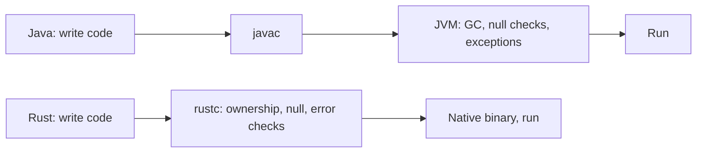

This page is for a Java developer reading Rust for the first time. It covers only the differences that change how you write and read code, not the full language.

## Overview

Java moves safety checks to run time: a garbage collector frees memory, a `NullPointerException` signals a missing value, and exceptions signal failure. Rust moves most of those checks to compile time. The compiler decides who owns each value and when it is freed, so there is no collector and no runtime to ship.



The cost is a stricter compiler. Most early frustration comes from the compiler refusing code that Java would accept and fail on later.

## The differences that matter first

| Topic | Java | Rust |
| --- | --- | --- |
| Memory | Garbage collector frees objects when nothing references them | Each value has one owner and is freed when the owner goes out of scope |
| Passing values | Object references are copied around freely | Passing a value moves it; borrow with `&` or `&mut` to keep using it |
| Missing value | `null` on any reference type | `Option<T>`, which you must handle before using the value |
| Errors | Checked and unchecked exceptions | `Result<T, E>` as a return value, `?` to pass errors up; `panic!` for bugs |
| Mutability | Mutable unless marked `final` | Immutable unless marked `mut` |
| Abstraction | Classes, interfaces, inheritance | Structs, traits, enums with data; no class inheritance |
| Generics | Erased at run time | Compiled separately for each concrete type |
| Threads | Data races are possible and found at run time | Data races fail to compile; `Send` and `Sync` mark what may cross threads |
| Build and packages | Maven or Gradle, JARs | Cargo, crates, workspaces |
| Run time | Needs a JVM | Native executable, no VM |

## Ownership replaces the garbage collector

In Java you can keep any number of references to one object. In Rust a value has one owner, and moving it ends the old name's right to use it.

```rust
fn main() {
    let name = String::from("ctx");
    let moved = name;
    let length = borrow_length(&moved);
    println!("{moved} {length}");
}

fn borrow_length(text: &String) -> usize {
    text.len()
}
```

Using `name` after `let moved = name;` is a compile error. Passing `&moved` lends the value without giving it up. You can have many `&` borrows or one `&mut` borrow at a time, never both.

## No null, no exceptions

A function that may return nothing says so in its type, and a function that may fail returns the failure.

```rust
fn find_port(config: &str) -> Option<u16> {
    config.parse().ok()
}

fn read_port(config: &str) -> Result<u16, std::num::ParseIntError> {
    let port = config.trim().parse::<u16>()?;
    Ok(port)
}
```

`?` returns early with the error if there is one. It is the closest match to an exception propagating up the call stack, except that it is visible in the signature.

## Traits and enums instead of inheritance

A trait is like a Java interface, but you can implement it for types you did not write. An enum can carry data per variant, which covers most of what a sealed interface with records does in Java.

```rust
enum Event {
    Started,
    Failed { code: u16 },
    Finished(String),
}

fn describe(event: &Event) -> String {
    match event {
        Event::Started => "started".to_string(),
        Event::Failed { code } => format!("failed {code}"),
        Event::Finished(name) => format!("finished {name}"),
    }
}
```

`match` must cover every variant, so adding a variant makes every incomplete `match` fail to compile.

## Concurrency and async

Rust rejects code that shares mutable data across threads without protection, at compile time. Async functions return futures that do nothing until awaited, and they need an executor such as `tokio` because the language does not bundle one. Java's virtual threads give blocking-style code on cheap threads, which has no direct Rust equivalent.

## Tooling

- `cargo build`, `cargo test`, `cargo fmt` and `cargo clippy` replace most of the Maven or Gradle plugin chain.
- `Cargo.toml` lists dependencies and optional features. A workspace groups several crates under one lock file.
- Error messages from `rustc` usually name the fix. Read them in full before changing code.

:::caution[Watch out]
Do not fight the borrow checker by cloning everywhere. A `.clone()` is fine for small values, but if you add one only to silence an error, check whether a borrow or a different ownership layout is the simpler answer.
:::

## What to do on Monday

1. Read one short Rust file next to a Java class you know and match each construct to the table above.
2. For every `null` check you would write in Java, look for the `Option` in the Rust version.
3. For every `try`/`catch` in Java, look for the `Result` and the `?` in the Rust version.
4. Run `cargo check` after each small edit instead of waiting for a full build.

## Limits and risks

- This page is a map, not a tutorial. It leaves out lifetimes in depth, macros, `unsafe`, and the module system.
- The mapping is approximate. Enums are not exactly sealed interfaces, and `?` is not exactly exceptions.
- Check any detail against the sources below before relying on it.

## Related

- [The Rust Programming Language](https://doc.rust-lang.org/book/): ownership (chapter 4), enums and `Option` (chapter 6), error handling (chapter 9), traits and generics (chapter 10)
- [The Cargo Book](https://doc.rust-lang.org/cargo/)
- [Java generics and type erasure](https://docs.oracle.com/javase/tutorial/java/generics/erasure.html)
- [Java virtual threads](https://docs.oracle.com/en/java/javase/21/core/virtual-threads.html)
