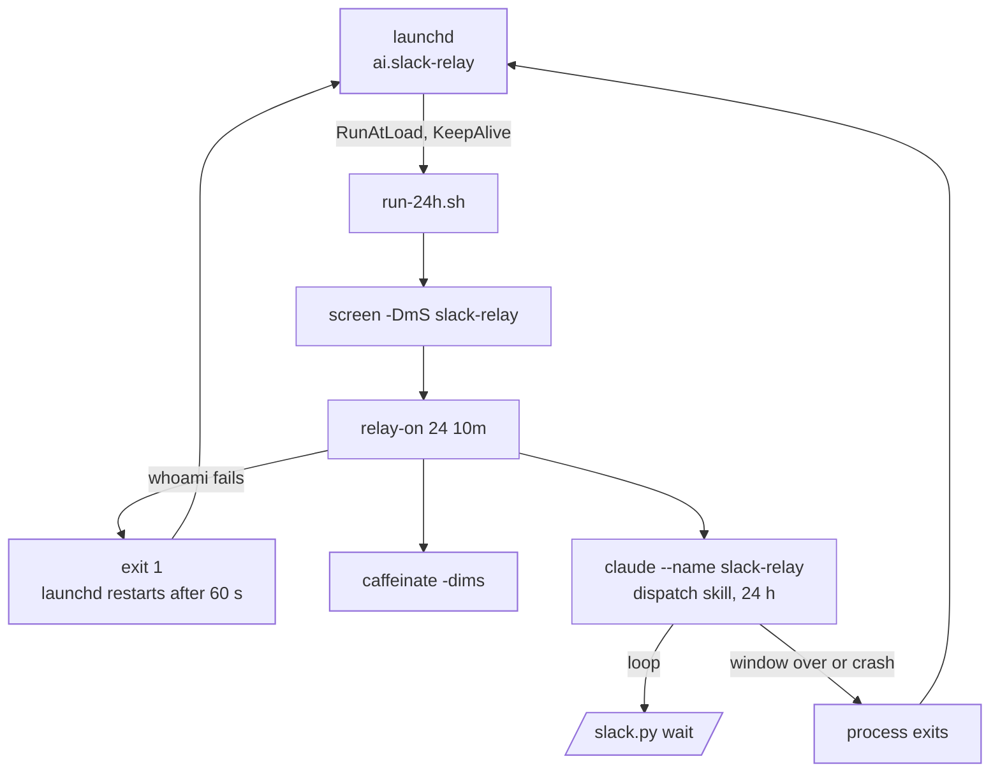

Operating guide for the slack-relay instance on the Mac mini. Written for the owner. For what it is and why, see [overview](../overview/). For first-time setup, see [setup guide](../setup/).

Items marked **unverified** were reasoned from the code or from how the tools normally behave and have not been exercised on this machine. Replace the marker once you have seen it work.

## Where everything is

| Thing | Location |
| ----- | -------- |
| Plugin (read-only cache) | `~/.claude/plugins/cache/fred-skills/slack-relay/<version>/` |
| Config (token, allowlist, workspaces) | `~/.config/slack-relay/config.json`, mode 600 |
| Launch script | `~/.config/slack-relay/run-24h.sh` |
| launchd job | `~/Library/LaunchAgents/ai.slack-relay.plist`, label `ai.slack-relay` |
| Log | `~/.config/slack-relay/relay.log` (launchd stdout and stderr only; the Claude session itself logs nothing here) |
| Terminal session | `screen` session named `slack-relay` |
| Slack app | api.slack.com/apps, app "Claude Relay", bot `slackrelay`, workspace `3235` |

## How the pieces start



`relay-on` ends after 24 hours, then launchd starts a fresh window. The `10m` catch-up makes the new window pick up messages from the gap.

## Daily checks

Run these in order. Stop at the first failure and go to [Troubleshooting](#troubleshooting).

```bash
launchctl list | grep slack-relay
screen -ls
python3 -I ~/.claude/plugins/cache/fred-skills/slack-relay/1.0.0/scripts/slack.py whoami
```

- First line shows a PID in the first column and `0` in the second. A `-` instead of a PID means the job is not running.
- `screen -ls` shows `slack-relay (Detached)`.
- `whoami` prints the bot, workspace and your `userIds`. An `error` key means the token or config is wrong.

End to end: send the app `hub: what is in the repo root?`. A reply within a minute means the whole chain works. The agent posts `Listening until <time>` at the start of each window.

## Common operations

| Goal | Command |
| ---- | ------- |
| Start | `launchctl load ~/Library/LaunchAgents/ai.slack-relay.plist` |
| Stop | `launchctl unload ~/Library/LaunchAgents/ai.slack-relay.plist`, then `screen -ls` to confirm the session is gone |
| Force a fresh window | `launchctl kickstart -k gui/$(id -u)/ai.slack-relay` (**unverified**) |
| Look at the live session | `screen -r slack-relay`, detach with Ctrl-A then D |
| Kill a stuck session | `screen -S slack-relay -X quit`; launchd starts a new one |
| Stop from the phone | Send `stop` as a plain word. It posts a summary and ends the window; launchd then starts a new one, so unload the job to stop for good (**unverified**) |
| Read the log | `tail -50 ~/.config/slack-relay/relay.log` |
| Change workspaces or user IDs | Edit `config.json`, then restart as above. Config is read on each `slack.py` call, but a running session keeps its own context |

Never run `screen -r` and type into the session while a task is running unless you mean to steer it. Your keystrokes go to the agent.

## Routine maintenance

- **Update the plugin:** `claude plugin update slack-relay@fred-skills`. `run-24h.sh` picks the newest installed version on the next start.
- **Rotate the token:** in the Slack app, OAuth & Permissions, reinstall or rotate. Put the new `xoxb-` in `config.json`, then restart. The old token stops working immediately.
- **Add a person:** add their member ID to `user_ids`. Each ID can run commands on this Mac, so add only people you would give a shell to.
- **Add a repo:** add an alias and absolute path under `workspaces`. Tasks outside these paths are refused.
- **After a macOS update or reboot:** the LaunchAgent only runs while you are logged in. Auto-login must be on, and Energy settings should start the Mac after a power failure. Verify with a real reboot (**unverified**).

## Troubleshooting

| Symptom | Likely cause | What to do |
| ------- | ------------ | ---------- |
| No reply at all | Job not running, or Mac asleep, or no network | Daily checks. `caffeinate` is started by `relay-on`, so also check `pmset -g` for sleep prevention |
| `whoami` returns `user_not_found` | `user_ids` still holds the placeholder or a wrong ID | Fix `user_ids` in `config.json` |
| `invalid_auth`, `not_authed`, `token_revoked`, `token_expired`, `account_inactive` | Bad or revoked token. These are fatal and the loop stops | Put a valid token in `config.json`, restart |
| `missing_scope`, `not_in_channel`, `channel_not_found` | App lacks a scope, or is not in the channel | Add the scope from the manifest and reinstall the app, or `/invite @Claude Relay` |
| `relay.log` repeats a start every ~60 s | `whoami` fails inside `relay-on`, so launchd restarts it in a loop | Run `whoami` by hand and fix the error it prints |
| Messages ignored | Sender not in `user_ids`, or message is from a bot, or it is a file with no text | By design. Check the ID and that the message has text |
| Replies stop and the agent waits | A tool needed a permission prompt at the terminal | `screen -r slack-relay`, answer it, and add an allow rule so it does not recur. Do not allow `git push` or deletes |
| Repeated or old task offered after restart | Catch-up replays history | Messages older than 15 minutes ask `run it? yes / skip` first. Answer `skip` if it already ran |
| Network errors or `rate_limited` | Slack slow or throttling. `slack.py` backs off (2, 4, 8, 16 s up to 30 s) and gives up after 5 failures | Wait. The window restarts through launchd. Raise `--interval` if it recurs |
| Task silent for long | Long task. The agent posts an update only after about 10 minutes | `status` as plain text, or `screen -r` |
| Session slow or forgetful late in a window | Long-running context (**unverified**) | Force a fresh window |

## Security routine

- Treat `config.json` like a password file. Keep mode 600 and keep it out of git.
- If the token may have leaked: rotate it first, then check the DM history for commands you did not send.
- The workspace should stay private. Anyone who can read it can read task history.
- Do not send secrets or customer data through Slack.
- Review `user_ids` and `workspaces` when people or repos change.

## Recovery checklist

1. `launchctl unload ~/Library/LaunchAgents/ai.slack-relay.plist`
2. `screen -S slack-relay -X quit` if the session is still listed.
3. `python3 -I <plugin dir>/scripts/slack.py whoami`. Fix whatever it reports.
4. `launchctl load ~/Library/LaunchAgents/ai.slack-relay.plist`
5. Send `hub: ping` and wait for a reply.

## Known gaps

- No permission rules are pre-approved, so any task that needs a new command will stall until you attach.
- The log file does not capture the agent's own output, only launchd's. Use `screen -r` to see what the agent did.
- Running `claude` inside `screen` under launchd is working as of 2026-11-22, but not proven across a reboot or a 24 hour window.
