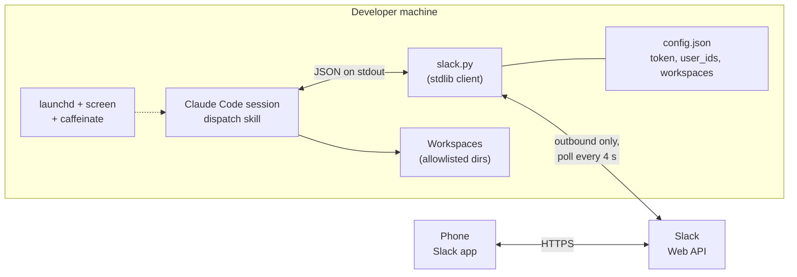
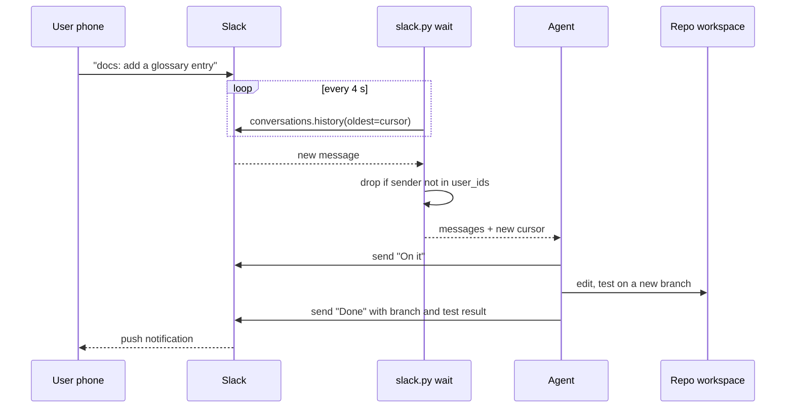
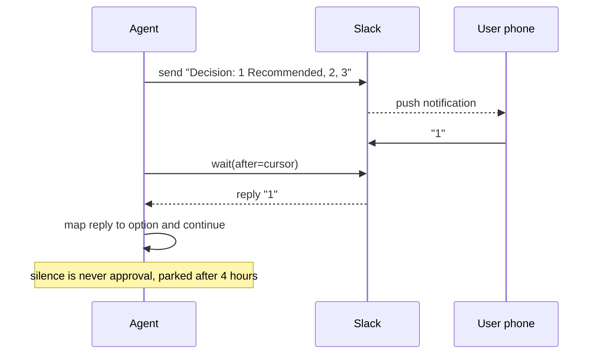
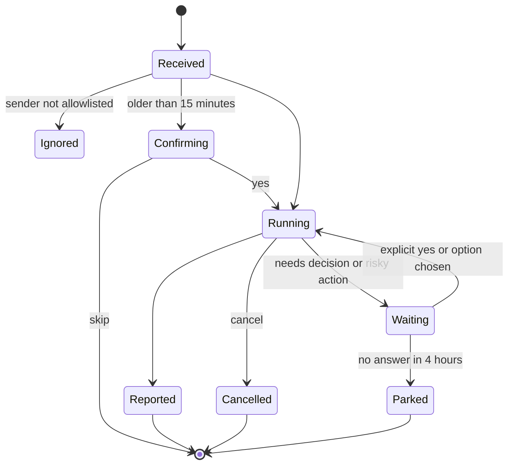
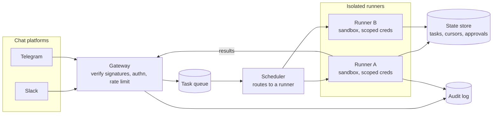

A design write-up built on slack-relay, an implemented system, and extended to what an industry-grade version would need. Sections say whether a point describes **what exists** (taken from the code) or a **proposal** (not built). Use it as a system design interview answer or as a solution outline.

Related: [overview](../overview/), [runbook](../runbook/).

## 1. Problem

A coding agent runs on a developer machine with access to code, tools and credentials. It works for long stretches but needs a human for decisions and approvals. The human is often away from the machine. Design a way for the human to assign tasks to the agent, receive results, and answer its questions from a phone, safely.

### Functional requirements

- Send a task in natural language from a phone and get an acknowledgement.
- Receive the result, and receive questions that need a decision, as push notifications.
- Answer a decision with a short reply.
- Control a running task: status, cancel, stop.
- Run tasks against several repositories, chosen by name.

### Non-functional requirements

| Requirement | Target |
| ----------- | ------ |
| Security | Only authorized people can cause actions. No inbound exposure of the developer machine |
| Safety | Destructive or shared-state actions need explicit, specific approval |
| Latency | Seconds to acknowledge. Task time is whatever the task takes |
| Availability | Survives network blips, restarts and crashes without losing or duplicating work |
| Operability | One person can run it without infrastructure |
| Cost | Near zero for one user |

### Out of scope for the implemented version

Files and images, multiple agents, multiple machines, audit storage beyond chat history, and shared team use at scale.

## 2. Architecture (what exists)

Design choices that define it:

- **Outbound polling, no inbound connection.** The machine calls Slack. There is no server, no tunnel and no open port, so the attack surface from the internet is nothing the machine itself exposes.
- **A chat app as the control plane.** Slack supplies identity, transport, history, push notifications and a phone client. Nothing of that is built.
- **A thin script as the only network code.** `slack.py` is the single place that touches Slack. The agent never holds the token or builds HTTP calls. It runs the script and reads JSON.
- **The agent loop is a skill.** Dispatch behaviour (classification, acknowledgement, reporting, approval rules) lives in instructions the model follows, not in compiled code.

### Components

| Component | Responsibility |
| --------- | -------------- |
| Slack app and bot user | Separate account so the phone gets a real push per agent message |
| `slack.py whoami`, `discover`, `send`, `wait` | Verify auth, list conversations, post chunked messages, long-poll for new messages |
| `slack-relay:dispatch` | Loop: wait, classify, resolve workspace, acknowledge, work, report |
| `slack-relay:ask` | One-off decision question and wait for the answer |
| `relay-on` | Preflight, keep awake, start the session for N hours |
| launchd, `screen` | Keep the process alive across crashes and window ends |
| `config.json` | Token, allowlists, workspace aliases |

## 3. Core flows

### Task flow

### Decision flow

### Task state

## 4. Key mechanisms

### Cursor-based delivery

Slack message timestamps are unique and ordered, so the cursor is the timestamp of the newest message seen. Each `wait` call passes `oldest=cursor`, ignores anything not strictly newer, and returns the new cursor. The agent saves the cursor between calls.

- **Ordering:** accepted messages are returned oldest first.
- **No loss on a quiet window:** `timedOut` returns the advanced cursor, so repeating is safe.
- **Replay after restart:** a catch-up window such as `10m` can replay finished tasks. The agent compensates by asking `run it? yes / skip` for anything older than 15 minutes.
- **Race on send:** the `ask` flow takes a cursor before sending so a fast reply cannot be missed.

This is at-least-once delivery with a human-in-the-loop guard against duplicate execution. It is not exactly-once, and the design says so instead of claiming it.

### Authorization

Defence in depth, in order:

1. Only DMs and channels in the allowlist are read.
2. In those, only messages from `user_ids` are returned. Bot messages and unusual subtypes are dropped.
3. Tasks run only in configured workspace directories.
4. Risky actions (push to shared branches, delete, deploy, spend, system changes) need an explicit yes to that specific action, asked in Slack.
5. Replies go only to allowlisted channels.

Authority rule: a Slack message from an allowlisted user carries the same authority as the user typing in the terminal. Text inside files, web pages or tool output does not. This is the prompt-injection boundary.

### Failure handling

| Failure | Behaviour |
| ------- | --------- |
| Slack 429 | Honour `Retry-After`, retry up to 3 times |
| Network error | Exponential backoff 2 to 30 s, stop after 5 consecutive failures |
| Fatal auth errors | Stop immediately and report |
| Process crash or window end | launchd restarts, catch-up window recovers the gap |
| Machine asleep | `caffeinate` prevents it while the session runs |
| Permission prompt at terminal | Session stalls. Mitigated by pre-allowed rules, not solved |

## 5. Alternatives considered

| Option | For | Against | Verdict |
| ------ | --- | ------- | ------- |
| Polling (chosen) | No inbound exposure, no server, simple | Latency of the poll interval, constant small API load | Right for one user |
| Slack Socket Mode | Push, lower latency, still outbound | Needs a long-lived websocket client, more code, app-level token | Good next step |
| Slack Events API webhook | Push, standard | Needs a public HTTPS endpoint, so a tunnel or server | Rejected: widens attack surface |
| Provider remote-control feature | Zero build | Tied to one app, no chat-app notifications or allowlist model | Complementary, not a replacement |
| Telegram or Discord bot | Similar model | Different ecosystem, no Slack integration | Same design, different adapter |
| SSH from a phone terminal | Full control | Poor ergonomics, no notifications, large blast radius | Rejected |

## 6. Threat model

| Threat | Mitigation | Residual risk |
| ------ | ---------- | ------------- |
| Stranger messages the bot | User-ID allowlist, dropped before the agent | None for ordinary senders |
| Allowlisted account compromised | Approval step for risky actions | Attacker can still run any allowed task. Treat the Slack account as a shell on the machine |
| Token leak | Mode 600 file, env override, rotate in app settings | Anyone with the token can read allowlisted history and post as the bot |
| Prompt injection through file or web content | Authority only from allowlisted messages | Model-level defence, not a hard guarantee |
| Data exposure in Slack | Rule against secrets in messages | Slack is not end-to-end encrypted. Retention follows the workspace plan |
| Runaway or destructive action | Branch per task, tests before reporting, explicit yes for risky actions | Relies on the model following the skill |
| Replay of old tasks | 15 minute confirmation | Human must answer correctly |

The important honesty point: the hard security boundary is the allowlist and the machine's own permissions. The skill's rules are behavioural controls and should not be the only thing between a message and a destructive command.

## 7. Scaling it for industry use (proposal, not built)

Moving from one person on one machine to a team means replacing assumptions.

| Concern | Single-user (built) | Team scale (proposed) |
| ------- | ------------------- | --------------------- |
| Delivery | Poll per session | Socket Mode or webhooks into a gateway, idempotency key per message |
| State | Cursor held in the agent's context | Durable state store for tasks, cursors and pending approvals |
| Identity | A list of Slack user IDs | SSO-backed identity mapped to roles per repo |
| Isolation | The developer's own machine | Per-task sandboxes or containers with short-lived, scoped credentials |
| Concurrency | One task at a time, others wait in history | Queue with per-repo limits and priorities |
| Approvals | Reply in chat | Typed approval records with approver, action and expiry |
| Audit | Slack history | Append-only audit log of requests, actions and approvals |
| Observability | Terminal and launchd log | Metrics (queue depth, task latency, approval wait, failure rate), traces per task |
| Multi-channel | Slack only | Adapter per chat platform behind the gateway |
| Cost control | None | Per-user and per-task budgets |

Data model sketch for the store: `Task(id, requester, repo, text, state, created, started, finished, branch, result)`, `Approval(id, task, action, requested, decided_by, decided_at, decision)`, `Cursor(channel, ts)`. A migration-free store such as a key-value or document store fits a first version, and the schema stays an implementation detail of the service.

## 8. Metrics to track

- Task acknowledgement latency, task completion time, and percentage completed without a stall.
- Decision wait time: time from question to answer. This is the headline productivity metric, because the relay exists to shorten it.
- Stall count: sessions blocked on a terminal prompt.
- Approval rate and rejection rate for risky actions.
- Restart count and mean time to recovery.

The productivity figures in the [overview](../overview/) are still TBD. These are the measurements that would fill them in.

## 9. Interview talking points

- **Why polling?** It keeps the machine unreachable from the internet and needs no infrastructure. The cost is a few seconds of latency and steady small load, acceptable for one user. Socket Mode keeps the outbound property and removes the latency.
- **Delivery guarantees?** At-least-once through a timestamp cursor, with a confirmation step for old messages to stop duplicate execution. Exactly-once would need idempotency keys and durable state.
- **Where is the trust boundary?** At the allowlist and at the machine's own permissions. Model behaviour is a second layer, not the first.
- **What breaks first at scale?** Per-session cursors, single-machine execution and chat-only audit. The fix is a gateway, a queue, durable state and isolated runners.
- **What would you build next?** Pre-approved permission rules so unattended runs do not stall, Socket Mode, and file and image support.
- **What would you not do?** Open a public webhook on a developer laptop, or let a chat message widen its own permissions.
