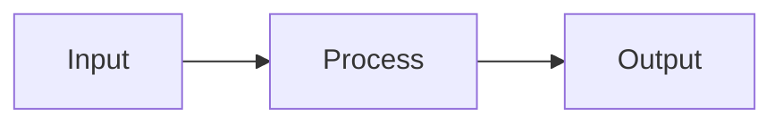

TODO: Say in two sentences what this page is for and who should read it.

## Overview

TODO: Describe the system or procedure in plain words.



## Steps

```bash title="Command name"
echo "replace with the real command"
```

:::caution[Watch out]
TODO: The one risk the reader must know before they start.
:::

## Limits and risks

TODO: List what does not work yet and what can go wrong.
