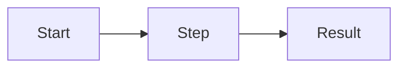

TODO: Open with the problem in two or three sentences. Say who feels it and when.

## The approach

TODO: Explain the idea in a short paragraph, then list the choices that matter.

- **First choice.** What you chose and what it costs.
- **Second choice.** What you chose and what it costs.

> [!NOTE]
> TODO: One thing the reader must not miss.

## What it costs

TODO: Be honest about limits, risks and what is still unfinished.

## Related

TODO: Link the matching doc, for example [the system design](../../slack-relay/system-design/).
